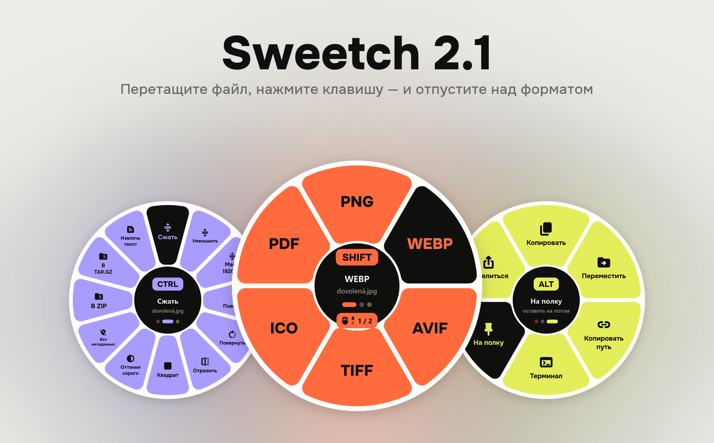
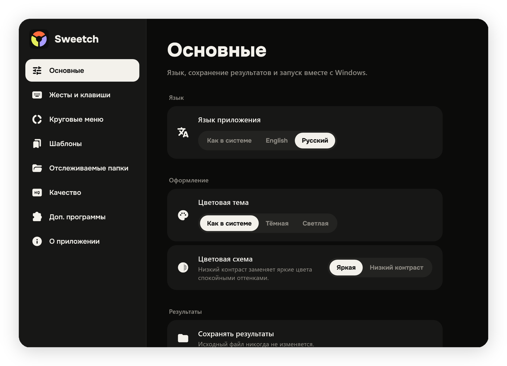
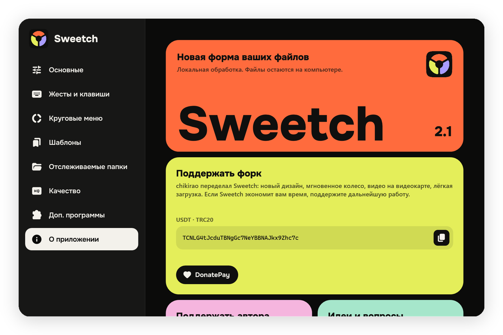
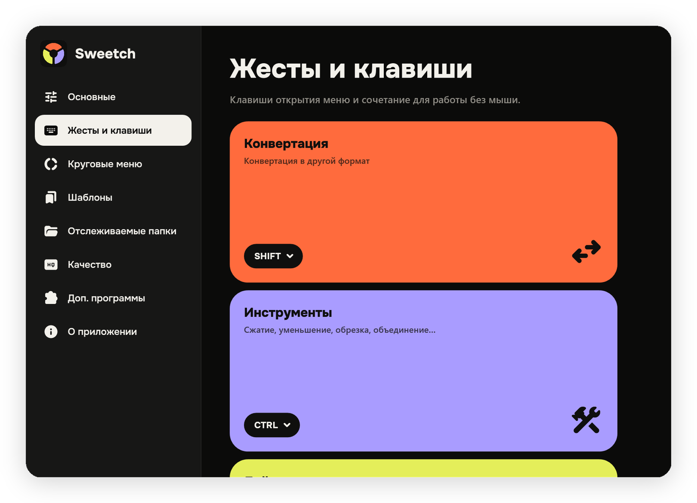
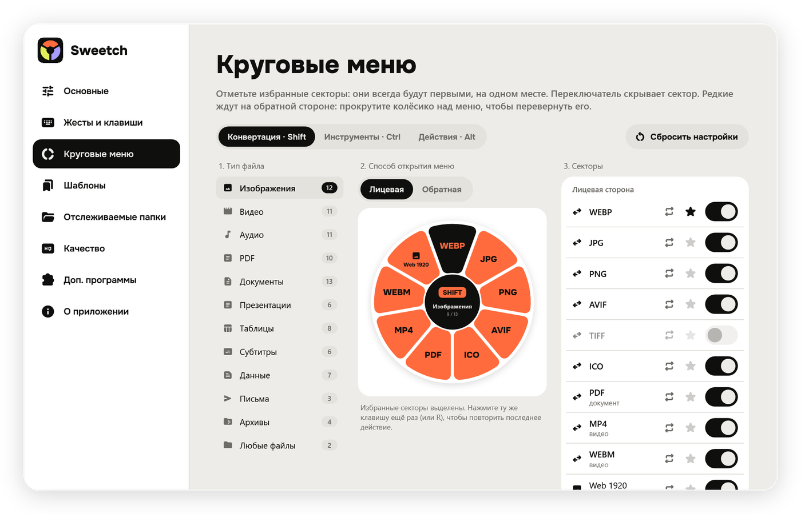

<p align="center">
  <picture>
    <source media="(prefers-color-scheme: dark)" srcset="docs/hero-dark.png" />
    
  </picture>
</p>

<p align="center">
  <a href="https://github.com/chikirao/Sweetchiki/releases/latest"></a>
  <a href="https://github.com/chikirao/Sweetchiki/releases"></a>
  
  
  <a href="LICENSE"></a>
  <a href="https://github.com/krllmrzv/Sweetch"></a>
</p>

<p align="center">
  <b>Файловый конвертер для Windows с круговым меню.</b><br />
  Перетащите файл, нажмите <kbd>Shift</kbd>, <kbd>Ctrl</kbd> или <kbd>Alt</kbd> — и отпустите над нужным сектором.
</p>

<p align="center">
  <a href="https://github.com/chikirao/Sweetchiki/releases/download/v2.1.2/Sweetch-2.1.2-Setup-win-x64.exe"></a>
  <a href="https://github.com/chikirao/Sweetchiki/releases/download/v2.1.2/Sweetch-2.1.2-win-x64.zip"></a>
</p>

<p align="center">
  <a href="#три-клавиши--три-колеса">Как пользоваться</a> ·
  <a href="#что-нового-в-20">Что нового</a> ·
  <a href="#скриншоты">Скриншоты</a> ·
  <a href="#поддержать">Поддержать</a> ·
  <a href="#сборка">Сборка</a>
</p>

> [!NOTE]
> Это форк [krllmrzv/Sweetch](https://github.com/krllmrzv/Sweetch) от [chikirao](https://github.com/chikirao): полный редизайн и оптимизация. Автор оригинального Sweetch — [@mmmorozov](https://t.me/mmmorozov).

## Три клавиши — три колеса

<table>
  <tr>
    <td width="33%" valign="top">
      <br /><br />
      Другой формат: JPG, PNG, WebP, AVIF, PDF, MP4, MP3, DOCX, Markdown, XLSX, CSV и ещё десятки.
    </td>
    <td width="33%" valign="top">
      <br /><br />
      Сжать, уменьшить, обрезать, повернуть, объединить PDF, убрать звук или метаданные, упаковать в архив.
    </td>
    <td width="33%" valign="top">
      <br /><br />
      Скопировать, переместить, скопировать путь, открыть терминал, отложить на полку, поделиться.
    </td>
  </tr>
</table>

Отпустите файл в центре колеса — отмена. Без мыши: выберите файлы в Проводнике и нажмите <kbd>Ctrl</kbd> + <kbd>Alt</kbd> + <kbd>Space</kbd>. Ещё Sweetch есть в контекстном меню Проводника и в трее рядом с часами.

## Что нового в 2.1

- **Сотня новых форматов:** PSD, JPEG XL, HEVC, Outlook MSG, Apple Pages, Numbers и Keynote, LaTeX, YAML, TOML, vCard, ASS, LRC и другие — полная таблица ниже
- **Вторая страница колеса** с редкими форматами — колёсиком мыши или Tab, номер страницы в центре
- **Субтитры в TXT с таймкодами**, из видео и из файлов субтитров; любая кодировка → UTF-8
- **Обновления в один клик** прямо из программы
- **Поиск по формату** в «Доп. программах»
- Обучение при первом запуске

Все изменения — в [CHANGELOG.md](CHANGELOG.md).

## Что нового в 2.0

<table>
  <tr>
    <th width="50%">🎨 Редизайн</th>
    <th width="50%">⚡ Оптимизация</th>
  </tr>
  <tr>
    <td valign="top">

- Колесо из крупных цветных блоков, свой цвет у каждой клавиши
- Никаких всплывающих секторов, свечения и анимаций
- Жирный шрифт Onest и залитые иконки Material Symbols
- Новые настройки: цветные плитки, понятные разделы, тонкая прокрутка
- Тёмная и светлая темы, схема «Низкий контраст»
- Раскладка подстраивается под узкое окно
- Новый логотип и иконка в трее

</td>
    <td valign="top">

| | 1.0 | 2.0 |
| --- | --- | --- |
| Открытие колеса | до 0,6 с | **~5 мс** |
| Видео 1080p, 20 с | 9 с | **2,6 с** |
| 12 фото → WebP | 10,4 с | **3,8 с** |
| PDF 400 стр. → PNG | 3,3 с | **0,24 с** |
| Размер программы | 355 МБ | **160 МБ** |
| Память в фоне | — | **~60 МБ** |

</td>
  </tr>
</table>

Видео кодируется на видеокарте NVIDIA, Intel или AMD, если она это умеет (замер — на NVIDIA); если не вышло, Sweetch сам перекодирует на процессоре. Pandoc больше не входит в сборку и скачивается при первой конвертации документа. Таблицы больше не сканируют все шрифты Windows.

## Скриншоты

<p align="center">
  
  
</p>
<p align="center">
  
  
</p>

## Скачать

| Вариант | Как запустить |
| --- | --- |
| **[Установщик EXE](https://github.com/chikirao/Sweetchiki/releases/download/v2.1.2/Sweetch-2.1.2-Setup-win-x64.exe)** | Запустите установщик: программа появится в меню «Пуск» и удаляется через настройки Windows. |
| **[Архив ZIP](https://github.com/chikirao/Sweetchiki/releases/download/v2.1.2/Sweetch-2.1.2-win-x64.zip)** | Распакуйте всю папку и запустите `Sweetch.exe`. |

Нужна Windows 10 (1809+) или 11, x64; .NET уже внутри. [Все файлы и контрольные суммы SHA-256](https://github.com/chikirao/Sweetchiki/releases/latest). Версия 1.0 — в [оригинальном репозитории](https://github.com/krllmrzv/Sweetch/releases/tag/v1.0).

<details>
<summary><b>Форматы и доп. программы</b></summary>
<br />

| Тип | Открывает | Сохраняет |
| --- | --- | --- |
| Изображения | JPG, PNG, WebP, AVIF, HEIC, TIFF, BMP, GIF, ICO, JPEG XL, JPEG 2000, PSD/PSB, TGA, QOI, DDS, PPM, PCX, OpenEXR, HDR, CUR, APNG, MNG, GIMP XCF, DICOM; RAW с камер (CR2/CR3, NEF, ARW, RAF, DNG, ORF, RW2 и др.); вектор SVG, SVGZ, EMF, WMF | JPG, PNG, WebP, AVIF, JPEG XL, TIFF, BMP, GIF, ICO, PDF |
| Видео | MP4, MOV, MKV, WebM, AVI, WMV, FLV, MPEG, TS/MTS, M2TS, 3GP, OGV, VOB, MXF, DivX, ASF, RM, F4V | MP4 (H.264 и HEVC), MOV, MKV, WebM, GIF, MP3, M4A; субтитры из видео в SRT |
| Аудио | MP3, M4A, AAC, WAV, FLAC, OGG, Opus, AIFF, WMA, AMR, APE, WavPack, TTA, DSD (DSF/DFF), DTS, AC3, E-AC3, MKA, CAF, AU, VOC, W64 | MP3, M4A, WAV, FLAC, OGG, Opus, AIFF |
| Документы | DOCX, DOC, ODT, RTF, Markdown, HTML, TXT, EPUB, DOCM, DOTX, WPS, WPD, Apple Pages, FODT, OTT, LaTeX, reStructuredText, Org, AsciiDoc, Typst, Jupyter, FB2, Textile, MediaWiki, DocBook, OPML, Djot | DOCX, PDF, ODT, Markdown, HTML, TXT, EPUB, RTF |
| Субтитры | SRT, VTT, ASS/SSA, LRC, SAMI, TTML/DFXP, MicroDVD; любая кодировка (Windows-1251 и др.) | SRT, VTT, ASS, LRC, TXT (только текст или с таймкодами); всё в UTF-8 |
| Данные | JSON, JSON Lines, YAML, TOML, XML; контакты vCard (VCF) | друг в друга; CSV и XLSX из списков записей; таблица → JSON или VCF |
| PDF | PDF | JPG, PNG, многостраничный TIFF, CBZ, TXT, Markdown, DOCX, PPTX; объединить, разделить, выбрать страницы (1-3, 5, 8-) |
| Таблицы | XLSX, XLS, ODS, CSV, TSV, шаблоны XLT/XLTX/OTS, FODS, Apple Numbers, ET | XLSX, CSV, TSV, ODS, PDF, HTML, JSON, VCF |
| Презентации | PPTX, PPT, ODP, PPTM, POTX, PPSX, OTP, FODP, Apple Keynote | PDF, PNG, JPG, PPTX, ODP, DOCX (слайд на страницу) |
| Письма и страницы | EML, Outlook MSG, MHTML | HTML, PDF, EML; вложения — в папку |
| Архивы | ZIP, 7Z, RAR, TAR и сжатые TAR | ZIP, TAR, TAR.GZ |

Доступные операции зависят от типа файла. Какая доп. программа нужна для формата, видно в настройках: «Доп. программы» → поиск по формату. [План добавления остальных форматов](docs/FORMATS-ROADMAP.md).

Pandoc для документов и разметки и FFmpeg для аудио и видео скачиваются при первой конвертации, которой они нужны, с проверкой SHA-256. LibreOffice для части операций Office/PDF устанавливается отдельно. Пока чего-то не хватает, настройки напоминают об этом плашкой с переходом в «Доп. программы». Обработка файлов локальная.

</details>

<details>
<summary><b>Где что хранится</b></summary>
<br />

Настройки — `%APPDATA%\Sweetch`, загружаемые программы — `%LOCALAPPDATA%\Sweetch\tools`. Скриншоты и виртуальные вложения сохраняются в `Downloads\Sweetch`. Исходные файлы не перезаписываются. Раз в несколько часов Sweetch спрашивает у GitHub, вышел ли новый релиз, и предлагает обновиться: установленная версия ставит новый установщик сама, версия из ZIP заменяет свои файлы и перезапускается. Загрузка сверяется с SHA-256 от GitHub. Проверку можно выключить в настройках. Обратная связь открывает Telegram; встроенной отправки сообщений на сторонний сервер нет.

</details>

## Поддержать

<table>
  <tr>
    <td width="50%" valign="top">
      <h3>💛 Форк — chikirao</h3>
      Редизайн, оптимизация и эта версия Sweetch. Если программа экономит вам время — поддержите дальнейшую работу.<br /><br />
      <a href="https://donatepay.ru/don/1539219"></a><br /><br />
      USDT · TRC20<br />
      <code>TCNLG4tJcduTBNgGc7NeYBBNAJkx9Zhc7c</code>
    </td>
    <td width="50%" valign="top">
      <h3>🩷 Оригинал — @mmmorozov</h3>
      Автор Sweetch. Новости и обратная связь — в <a href="https://t.me/mmmorozov">Telegram-канале</a>.<br /><br />
      <a href="https://donatepay.ru/don/1539048"></a><br /><br />
      USDT · TRC20<br />
      <code>TQHTy7kbk3ngYTUfrTpEeSi3hP38tnqJNU</code>
    </td>
  </tr>
</table>

## Сборка

Нужен .NET SDK 10; если его нет, `build.ps1` сам скачает его в папку `.dotnet`. Перед сборкой закройте Sweetch, если он запущен из `publish`.

```powershell
./build.ps1
dotnet test tests/Sweetch.Tests -c Release
./publish/Sweetch.exe --self-test ./self-test
python scripts/build-readme-art.py ./self-test   # картинки для README
```

Self-test рисует все экраны в `self-test/` (обе темы, оба языка, минимальная ширина окна) и пишет в `self-test.txt` время открытия колеса и страниц настроек. Установщик: [Inno Setup 6 или 7](https://jrsoftware.org/isdl.php), затем `./scripts/build-installer.ps1` — результат в `artifacts/`.

GitHub Actions проверяет программу и установку, собирает ZIP и EXE с контрольными суммами и публикует релиз по тегу `v*`.

## Лицензия

[MIT](LICENSE). Уведомления о сторонних компонентах — в [THIRD-PARTY-NOTICES.md](THIRD-PARTY-NOTICES.md). Название Sweetch — проект @mmmorozov; редизайн и оптимизация версии 2.0 — chikirao.
